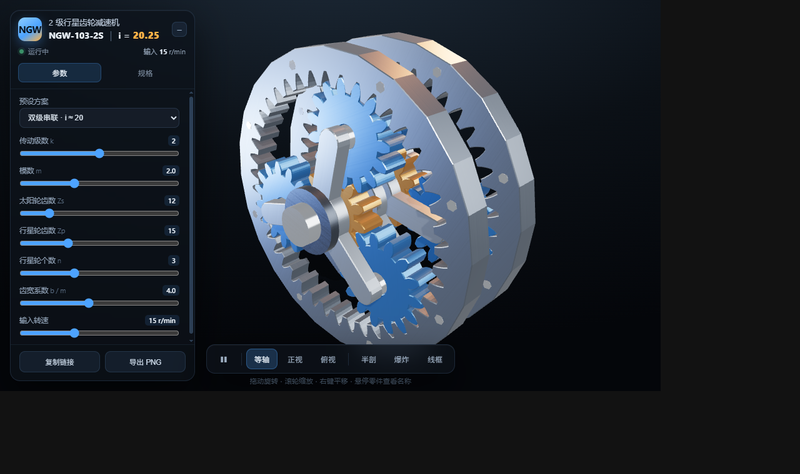

# NGW 行星齿轮减速机 · 在线选型与三维预览

产品级 Web 3D 应用：浏览器里拖动滑块即可完成**多级行星减速机选型**，几何、啮合相位、运动学、设计校核实时重建。

单文件实现（`index.html`），仅依赖 CDN 上的 three.js r169。



## 界面构成

| 区域 | 内容 |
| --- | --- |
| 产品头 | 品牌标识、自动型号 `NGW-{外径}[-{级数}S]`、总传动比、运行状态灯、输入转速 |
| 参数页 | 预设方案 + 传动级数 / 模数 / Zs / Zp / n / 齿宽系数 / 输入转速 |
| 规格页 | 结构参数、传动性能（级数、单级比、总比…）、零件图例、设计校验清单 |
| 底部工具栏 | 播放暂停、等轴 / 正视 / 俯视、半剖、爆炸、线框 |
| 页脚 | 复制分享链接、导出 PNG |
| 悬停提示 | 射线拾取零件，高亮并显示名称与关键参数 |

## 可调参数

| 参数 | 范围 | 说明 |
| --- | --- | --- |
| 传动级数 $k$ | 1 – 3 | 前级行星架驱动后级太阳轮，逐级串联 |
| 模数 $m$ | 1 – 4 | 决定整体尺寸 |
| 太阳轮齿数 $z_s$ | 8 – 32 | 中心金色齿轮 |
| 行星轮齿数 $z_p$ | 8 – 32 | 蓝色齿轮 |
| 行星轮个数 $n$ | 2 – 5 | 每级均布 |
| 齿宽系数 $b/m$ | 1 – 8 | 齿宽 = 系数 × 模数 |

预设：标准单级（i≈4.5）、重载单级（5 行星轮）、双级串联（i≈20）、紧凑单级（小模数）。

## 核心公式

**同轴条件**

$$z_r = z_s + 2 z_p$$

**均布装配条件**

$$\frac{2(z_s+z_p)}{n}=\frac{z_s+z_r}{n}\in\mathbb{Z}$$

**邻接条件**

$$a\sin\frac{\pi}{n} > r_{p}+h_a$$

**单级传动比与运动学（内齿圈固定）**

$$i_1 = 1 + \frac{z_r}{z_s},\qquad \omega_c=\frac{\omega_s}{i_1},\qquad \omega_p'=-\left(\omega_s-\omega_c\right)\frac{z_s}{z_p}$$

**多级串联**

$$i = i_1^{\,k},\qquad \theta_{s,\text{第 }k\text{ 级}} = \frac{\theta_{s,\text{第 }k-1\text{ 级}}}{i_1}$$

> 前一级行星架与后一级太阳轮同轴刚性连接，所以第 $k$ 级太阳轮转角 = 上一级行星架转角 = $\theta/i_1^{k-1}$。每一级的啮合相位 $\omega_p'$ 只取决于本级太阳轮转角，因此逐级计算即可。

## 轴系结构（各轴段边界分明）

| 轴段 | 位置 | 运动 |
| --- | --- | --- |
| 输入轴 | 第 1 级太阳轮向后伸出箱体 | 与第 1 级太阳轮同转 |
| 输入轴承盖 | 箱体后端面外侧 | **固定不动**（不随轴转） |
| 级间联接轴 | 只跨过级间空隙，两端分别插入前级行星架轮毂与本级太阳轮 | 与第 $s$ 级行星架 / 第 $s+1$ 级太阳轮**同转速** |
| 联轴节 | 包在级间轴外（深色，双法兰盘） | 随级间轴同步转动 |
| 输出法兰 | 输出轴根部 | 与末级行星架刚性连接 |

> 早期版本让每一级都带一根 18×模数长的「输入轴」，它会穿进前一级太阳轮内孔——同一个孔里套着内外两根不同转速的轴，视觉上重叠又不同步。现在级间轴只跨过空隙，并用**深色联轴节 / 轴承盖 / 输出法兰**把旋转件与固定件、不同轴段明确区分开。

## 视角策略

级数越多，等轴视角会越偏向侧面（`isoDir()` 按 $k$ 插值），否则各级沿视线方向重叠、看不出是串联结构。

## 渐开线齿廓

半径 $r$ 处的半齿厚角：

$$\varphi(r)=\frac{\pi}{2z}+\operatorname{inv}\alpha-\operatorname{inv}\alpha_r,\quad \alpha_r=\arccos\frac{r_b}{r},\quad \operatorname{inv}\alpha=\tan\alpha-\alpha$$

- 外齿轮：齿厚角 $=\varphi(r)$；内齿圈：$\dfrac{\pi}{z}-\varphi(r)$

每齿按「齿根 → 上升齿面 → 齿顶圆弧 → 下降齿面 → 齿根圆弧」采样，`ExtrudeGeometry` 拉伸 + 倒角成实体；内齿圈用 `holes` 挖出内齿廓。

## 啮合相位（随齿数变化，必须动态计算）

$t=0$（行星架转角为 0）时：

- 太阳轮：齿中心在 $0°$（$\psi_s=0$）
- 内齿圈：$\psi_r=\dfrac{\pi z_p}{z_r}$
- 行星轮 $i$（位置角 $\theta_i=i\cdot 360°/n$）：

$$\Phi_i=\left(1+\frac{z_s}{z_p}\right)\theta_i+\pi\left(1-\frac{1}{z_p}\right)$$

推导：设齿相位 $a=\dfrac{\theta-\psi}{2\pi/z}$，则外啮合 $a_{sun}+a_{planet}\equiv\tfrac12$、内啮合 $a_{ring}-a_{planet}\equiv\tfrac12$。两式相加消去 $\Phi$，得到与相位无关的相容条件

$$\theta_i\cdot\frac{z_s+z_r}{2\pi}\equiv\frac{\psi_s z_s+\psi_r z_r}{2\pi}-\frac{z_p}{2}\pmod 1$$

对全部 $i=1..n$ 成立，正是均布装配条件；解出 $\psi_r$ 即得上式。**多级时各级共用同一齿圈相位与行星轮相位**（各级太阳轮初相都为 0），因此级数增加不需要重算相位。

## 质感实现

- **摄影棚环境**：`PMREMGenerator` 烘焙自建场景（环境球 + 5 个亮度不同的柔光箱），金属才有方向性高光与暗部层次，比通用 RoomEnvironment 更接近产品渲染
- **程序化表面纹理**：Canvas 生成细噪声 + 拉丝纹理，作为 `roughnessMap` 复用，打破大面积纯色金属的塑料感
- **软阴影**：`PCFSoftShadowMap` + `ShadowMaterial` 承接面，零件之间产生自阴影，落地柔和投影
- **曝光与色调**：`ACESFilmicToneMapping`，按金属反射强度分配 `envMapIntensity`

## 工程实现要点

- **脏标记 + rAF 合并**：拖动滑块只置标记，下一帧统一重建
- **资源释放**：重建前遍历 `geometry.dispose()`，长期调参不泄漏显存
- **自动取景**：采样每一级齿圈前后端面整圆 + 轴向端点，迭代求距离；再按投影包围盒中心二次居中，并向右偏移避开左侧面板
- **半剖**：`localClippingEnabled` + 材质 `clippingPlanes`，剖切时切到 `DoubleSide`
- **爆炸视图**：三级分离同时进行 —— 级与级之间 $0.62R$、级内太阳轮组与行星架各 $0.40R$、行星架两片腹板再各 $0.10R$（$R$ 为齿圈外半径）；帧内插值平滑过渡，切到爆炸态时按新的包围尺寸重新取景
- **整组高亮**：每个零件登记 `gid`（装配组），悬停任意零件时**同组零件一起高亮**（弱），当前零件再单独加亮（强）；分组为「固定件 / 输入轴组件 / 第 n 级太阳轮组件 / 第 n 级行星架总成」
- **悬停提示**：射线拾取 + 组内材质切换，显示零件名 + 所属装配总成 + 关键参数
- **分享**：参数写入 URL hash（含 `k`），范围钳制后还原
- **导出**：同帧渲染后 `toDataURL`，合成背景下载 PNG
- **快捷键**：`Space` 播放/暂停、`1/2/3` 视角、`S` 半剖、`E` 爆炸、`W` 线框、`R` 重置视角

## 代码结构

```
1. 可配置参数与派生量      derive() → D（半径、相位、分度、板厚、包围尺寸…）
2. 渐开线齿廓              gearProfile() / extrude() / gearShape() / spiderShape()
3. 渲染器 / 相机 / 灯光 / 摄影棚环境
4. 材质（程序化纹理 + 悬停高亮副本）
5. 状态
6. 参数化装配              build() / applyExplode()（k 级循环）
7. 视角与取景              frameModel() / setView()
8. 运动学与主循环          applyKinematics() / animate()
9. 悬停拾取                updateHover()
10. UI                     滑块 / 预设 / 页签 / 工具栏 / 分享导出
```
